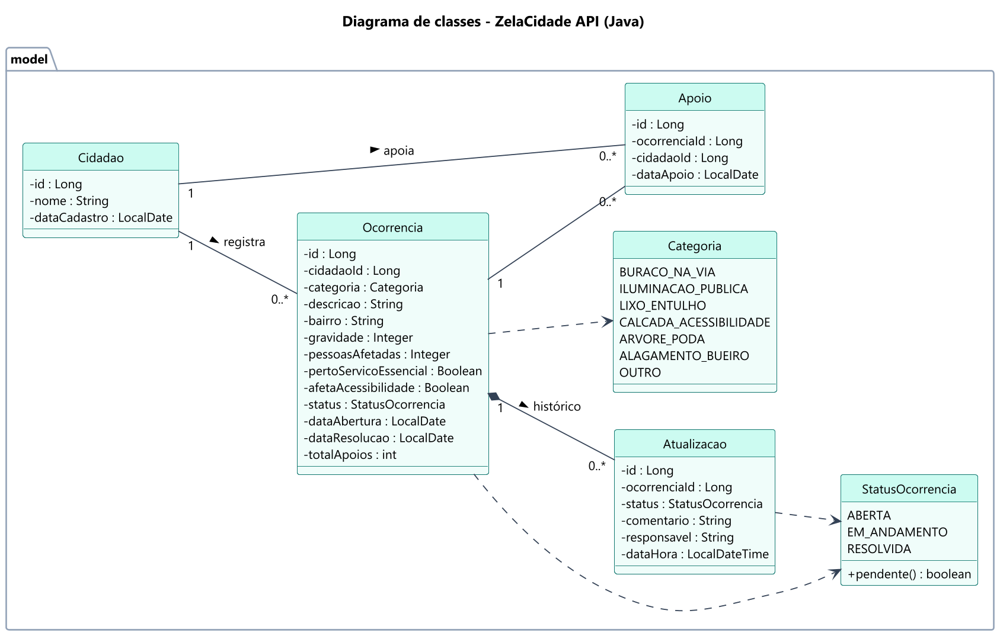
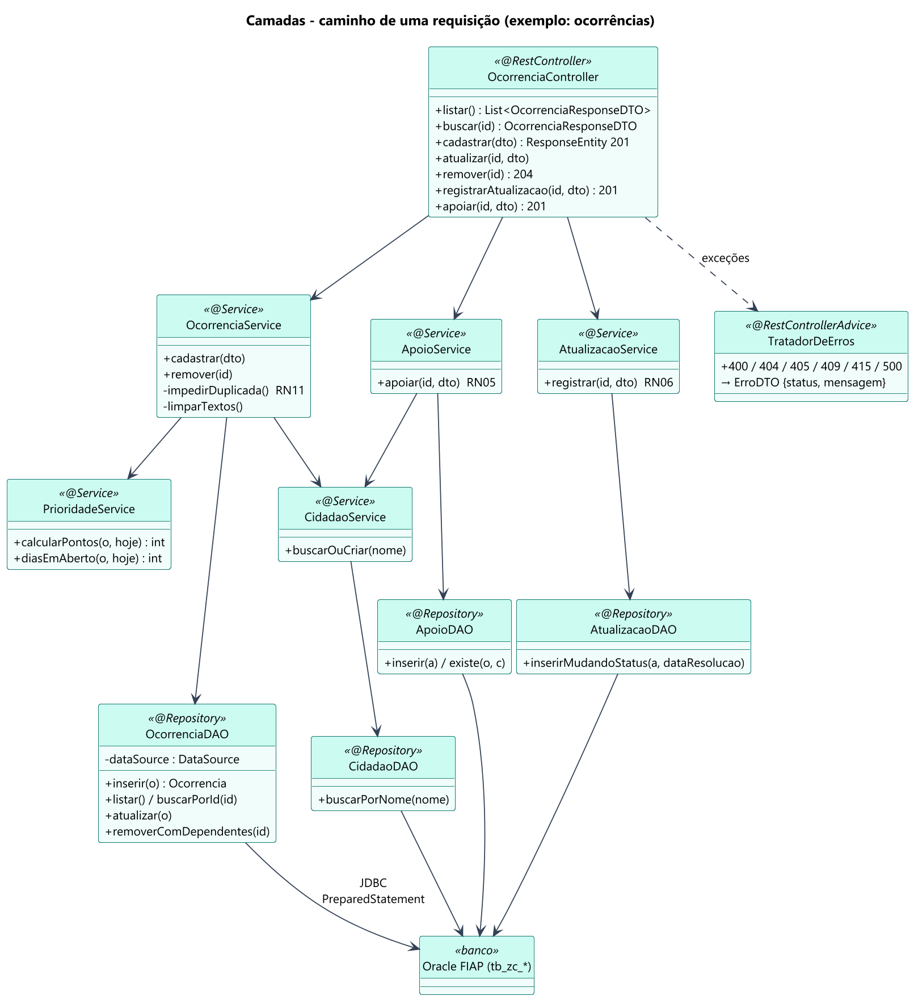
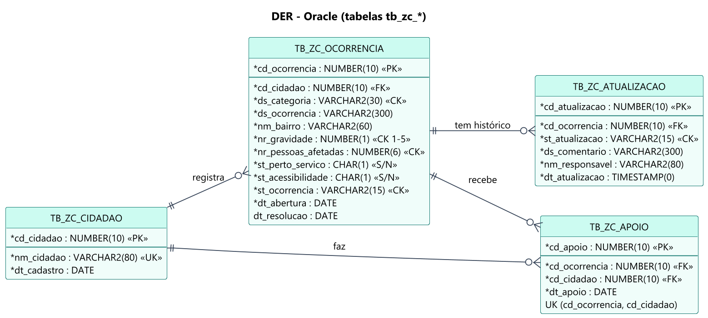

# ZelaCidade API (Java)

API REST do **ZelaCidade**: o cidadão relata um problema de zeladoria (buraco, poste apagado, lixo, calçada quebrada…), os vizinhos apoiam e a prefeitura atende pela **fila de prioridade**. Cada ocorrência ganha pontos por uma regra pública e igual para todos.

**Grupo INOVEX · FIAP · Global Solution 2026/2 · Domain Driven Design Using Java**

| Integrante | RM | Turma |
|---|---|---|
| Luigi Tormim Carqueijeiro | RM572424 | 1TDSPH |
| Cauã De Souza Vasconcellos | RM573349 | 1TDSPH |
| Gabriel Soares Tavares | RM571113 | 1TDSPV |

## Links

| O quê | Link |
|---|---|
| API no ar (Render) | https://zelacidade-api.onrender.com |
| Repositório | https://github.com/LuigiT2703/zelacidade-api |
| Front-end (React) | `[LINK DO FRONT]` |
| Vídeo | `[LINK DO VÍDEO]` |

> O plano gratuito do Render "dorme" sem uso. A **primeira** chamada do dia pode levar uns 50 segundos. Depois disso, tudo responde na hora.

## Tecnologias

- Java 21 · Spring Boot 3.4 · Maven (wrapper incluso: não precisa instalar o Maven)
- **JDBC puro** com padrão DAO. Cada DAO recebe o `DataSource` pelo construtor e usa `PreparedStatement` com try-with-resources. **Não usa** JPA, Hibernate, Spring Data nem JdbcTemplate.
- Oracle da FIAP (driver `ojdbc11`)
- DTOs com **ModelMapper** e **Bean Validation** (mensagens em português)
- Exceções próprias com `@RestControllerAdvice`. Todo erro devolve `{ "status": 404, "mensagem": "..." }`, nunca stack trace.
- CORS liberado para o front (localhost e o endereço da Vercel, por variável de ambiente)
- Dockerfile multi-stage para deploy no Render

## Como rodar na sua máquina

**Pré-requisito:** JDK 21 e um usuário no Oracle da FIAP.

1. **Crie as tabelas.** Abra `sql/criar_tabelas.sql` no SQL Developer e rode com **F5** (executar script). Ele apaga e recria só as tabelas `tb_zc_*`, e insere os mesmos 6 exemplos do motor em Python.
2. **Configure o acesso ao banco.** Copie `.env.example` para `.env` e preencha `DB_USER` e `DB_PASSWORD`. O `.env` está no `.gitignore` e nunca vai para o Git.
3. **Suba a API:**
   ```bash
   ./mvnw spring-boot:run
   ```
   No Windows (cmd/PowerShell): `mvnw.cmd spring-boot:run`
4. Abra http://localhost:8080/. Para testar todas as rotas e erros, use `requests/zelacidade.http` (VS Code com a extensão REST Client, ou IntelliJ).

### Variáveis de ambiente

| Variável | Para quê | Obrigatória |
|---|---|---|
| `DB_URL` | JDBC do Oracle, ex.: `jdbc:oracle:thin:@oracle.fiap.com.br:1521/ORCL` | sim |
| `DB_USER` | usuário do banco | sim |
| `DB_PASSWORD` | senha do banco | sim |
| `FRONT_URL` | endereço do front na Vercel (sem barra no fim), liberado no CORS | no deploy |
| `PORT` | porta HTTP (o Render preenche sozinho; local usa 8080) | não |

Nenhuma senha fica no código, no README ou no repositório.

## Rotas

**Base local:** `http://localhost:8080`. Todo corpo é JSON.

### As do contrato (usadas pelo front)

| Método | Rota | Sucesso | Erros |
|---|---|---|---|
| GET | `/ocorrencias` | 200 + lista (com `pontos`) | — |
| GET | `/ocorrencias/{id}` | 200 | 400 · 404 |
| POST | `/ocorrencias` | 201 + `Location: /ocorrencias/{id}` | 400 · 409 |
| PUT | `/ocorrencias/{id}` | 200 | 400 · 404 · 409 |
| DELETE | `/ocorrencias/{id}` | 204 | 404 · 409 |
| GET | `/ocorrencias/{id}/atualizacoes` | 200 + histórico (mais recente primeiro) | 404 |
| POST | `/ocorrencias/{id}/atualizacoes` | 201 + `Location: /atualizacoes/{id}` | 400 · 404 |
| POST | `/ocorrencias/{id}/apoios` | 201 + `{ "ocorrenciaId": 1, "totalApoios": 4 }` | 400 · 404 · 409 |

### CRUD completo das outras entidades

| Método | Rota |
|---|---|
| GET | `/ocorrencias/{id}/apoios` |
| GET · PUT · DELETE | `/atualizacoes/{id}` |
| GET · PUT · DELETE | `/apoios/{id}` |
| GET · POST | `/cidadaos` |
| GET · PUT · DELETE | `/cidadaos/{id}` |
| GET | `/` (informações da API) |

### Exemplo: registrar uma ocorrência

```http
POST /ocorrencias
Content-Type: application/json

{
  "categoria": "ALAGAMENTO_BUEIRO",
  "descricao": "Bueiro sem tampa na calçada em frente à escola municipal",
  "bairro": "Jardim São Luís",
  "gravidade": 5,
  "pessoasAfetadas": 200,
  "pertoServicoEssencial": true,
  "afetaAcessibilidade": false,
  "nomeCidadao": "Ana Lima"
}
```

**Valores aceitos:**
- **Categorias:** `BURACO_NA_VIA`, `ILUMINACAO_PUBLICA`, `LIXO_ENTULHO`, `CALCADA_ACESSIBILIDADE`, `ARVORE_PODA`, `ALAGAMENTO_BUEIRO` e `OUTRO`.
- **Status:** `ABERTA`, `EM_ANDAMENTO` e `RESOLVIDA`.

### Erros

| Código | Quando |
|---|---|
| 400 | campo inválido ou faltando, JSON quebrado, categoria/status inexistente, id que não é número, mudar para o mesmo status |
| 404 | id que não existe ou rota que não existe |
| 405 | método não permitido (ex.: PATCH) |
| 409 | regra de negócio (ver abaixo) |
| 415 | corpo que não é JSON |
| 500 | falha no banco; a mensagem é genérica e o detalhe fica só no log |

## Regra de prioridade (a mesma do motor em Python)

```
pontos = gravidade × 10
       + mín(pessoas afetadas ÷ 10, 20)
       + mín(dias em aberto × 2, 20)
       + 15 se fica perto de escola, hospital ou posto de saúde
       + 10 se afeta a acessibilidade
       + mín(apoios × 3, 15)          (máximo: 130)
```

Os dias contam pelo fuso de São Paulo. Se a ocorrência já foi resolvida, os dias param de contar na data da resolução.

## Regras de negócio

| Regra | O que faz | Onde |
|---|---|---|
| RN04 | Calçada sempre marca "afeta acessibilidade" | `OcorrenciaService` + CHECK no banco |
| RN05 | Não pode apoiar ocorrência resolvida, nem a própria, nem duas vezes (409) | `ApoioService` + UNIQUE no banco |
| RN06 | Ao resolver, grava a data de resolução; ao reabrir, apaga a data | `AtualizacaoService` + CHECK no banco |
| RN07 | Ocorrência resolvida não pode ser excluída (409); ids nunca são reaproveitados | `OcorrenciaService` + sequences |
| RN11 | Ocorrência igual a outra pendente (mesma categoria, bairro e descrição, sem diferenciar acento e maiúsculas) dá 409 | `OcorrenciaService` |
| — | Nome padronizado (minúsculas, sem espaços extras) antes de comparar | `Texto.padronizarNome` |
| — | Mudar para o status que já está dá 400 | `AtualizacaoService` |
| — | Cidadão com ocorrências ou apoios não pode ser excluído (409) | `CidadaoService` |

Duas operações rodam numa transação JDBC (commit/rollback):
- registrar uma atualização e mudar o status da ocorrência;
- excluir uma ocorrência com o histórico e os apoios dela.

## Estrutura

```
src/main/java/br/com/fiap/zelacidade
├── controller   rotas REST (@RestController)
├── service      regras de negócio e cálculo de pontos
├── dao          acesso ao Oracle com JDBC puro (PreparedStatement)
├── model        entidades do domínio + enums Categoria e StatusOcorrencia
├── dto          entrada (com Bean Validation) e saída da API
├── exception    exceções próprias (404, 409, 400, 500)
├── handler      TratadorDeErros (@RestControllerAdvice)
├── config       CORS e ModelMapper
└── util         datas no fuso de São Paulo e limpeza de texto
sql/criar_tabelas.sql       tabelas, sequences, constraints e dados de exemplo
requests/zelacidade.http    todas as rotas e todos os erros, prontos para testar
docs/                       diagrama de classes, camadas e DER
```

## Diagramas

**Classes do domínio**



**Camadas** (caminho de uma requisição)



**DER**



## Deploy no Render

1. No Render, crie um **New → Web Service** ligado a este repositório.
2. Em **Language**, escolha **Docker**. O Render usa o `Dockerfile` da raiz.
3. Em **Environment**, cadastre `DB_URL`, `DB_USER`, `DB_PASSWORD` e `FRONT_URL`. Não precisa cadastrar `PORT`.
4. Faça o deploy. Quando terminar, abra `https://SEU-SERVICO.onrender.com/ocorrencias`.
5. No front (Vercel), configure `VITE_API_URL` com esse endereço e faça um novo deploy.
